# ansible-llm-platform

[](https://github.com/santoshmyakala/ansible-llm-platform/actions/workflows/ci.yml)


A **self-hosted LLM platform for a team, provisioned end to end with Ansible**. One playbook turns plain Ubuntu servers into:

- **Hardened nodes.** Key-only SSH, kernel hardening, security-only unattended upgrades, and an nftables firewall generated from the inventory.
- **Model servers on whatever hardware you have.** **vLLM** on NVIDIA GPUs, and **llama.cpp** on CPUs or on AMD/Intel GPUs (Vulkan). Every downloaded model is verified by SHA-256.
- **One OpenAI-compatible endpoint.** A small gateway checks per-team API keys (stored only as hashes), enforces request and token limits, routes to the least-busy healthy server, and **fails over** when one dies.
- **Monitoring built in.** Prometheus, Alertmanager and Grafana, with alerts on service levels: time to first token, error ratio, queueing.
- **A chat UI.** Open WebUI, using the gateway with its own team key.

The whole platform is installed on a fresh GitHub runner with a real model on every push, then installed again to prove nothing changes, then verified end to end.

<picture>
  <source media="(prefers-color-scheme: dark)" srcset="docs/diagrams/architecture-dark.svg">
  
</picture>

<sub>Animated diagrams generated from <a href="docs/diagrams/diagrams.yaml">docs/diagrams/diagrams.yaml</a> with <a href="https://github.com/santoshmyakala/santoshmyakala/tree/main/tools/archdiagram">archdiagram</a>.</sub>

## Roles

| Role | What it does |
|---|---|
| `platform` | Shared defaults (pinned image versions, ports, SLOs) and **preflight checks** that fail before anything changes: OS, addresses, secret strength, catalog references, unique ports |
| `hardening` | sshd drop-in (key-only, no root), sysctl hardening, unattended **security** upgrades that never touch Docker or the GPU stack, and the **firewall** (see below) |
| `docker_engine` | Docker CE from Docker's signed repository; merges a hardened `daemon.json`: log rotation, `live-restore`, `no-new-privileges` |
| `nvidia_toolkit` | NVIDIA Container Toolkit on NVIDIA hosts (checks for the driver rather than guessing one) |
| `node_exporter` | Host metrics, bound to the node's address |
| `model_cache` | Downloads GGUF models and **verifies their SHA-256**: a pinned hash, or the one Hugging Face publishes for the file. Records the source in `SOURCE.json` |
| `inference` | Runs each instance from the inventory: llama.cpp (CPU / CUDA / Vulkan build chosen per host) or vLLM. Removes instances no longer listed, and waits until every model is healthy |
| `llm_gateway` | Builds the gateway from [`gateway/`](gateway), renders its config from the inventory, validates it with the gateway's own `--check`, then swaps it in |
| `monitoring` | Prometheus, Alertmanager and Grafana. Targets are generated from the inventory; config is checked with `promtool` / `amtool`; **alert unit tests** run before every restart |
| `chat_ui` | Open WebUI configured as code: the gateway is its only provider, the admin comes from the vault, there's no open sign-up, and it downloads no models at start-up |

## Design decisions

| Decision | Why |
|---|---|
| **The firewall owns only its own nftables table** and is loaded by its own systemd unit | The usual `flush ruleset` also deletes Docker's rules. A table that is declared, deleted and recreated atomically leaves Docker alone. [ADR 0002](docs/decisions/0002-host-networking-and-firewall.md) |
| **Host networking for every container**; `verify.yml` asserts nothing publishes a port | Docker's published ports are DNAT'd past the INPUT chain, so a host firewall would silently not apply to them |
| **Rules generated from inventory groups, per service** | SSH and Grafana: admin networks only. Gateway and chat UI: client networks only. Model servers: the gateway and monitoring hosts only. Metrics: monitoring only. Adding a node updates every rule. |
| **A small, auditable gateway** instead of a general-purpose proxy | About 500 lines, 26 tests, no database. Keys stored as SHA-256 and compared in constant time; token budgets charged on actual usage; prompts never logged. [ADR 0001](docs/decisions/0001-own-gateway.md) |
| **Least-in-flight routing with failover** on connection errors and 5xx, but **not** on read timeouts | A dead node costs no failed requests. A slow generation isn't silently run twice on another GPU. |
| **Rolling inference updates** (`serial: 1`) | Because the gateway fails over, models can be upgraded one node at a time without an outage. |
| **Every model file verified** | A truncated or substituted multi-GB file is refused. Production pins the hash. [ADR 0003](docs/decisions/0003-model-integrity.md) |
| **llama.cpp and vLLM chosen per node**, with unified metrics | Use the hardware you have; dashboards and alerts don't care which engine answered. [ADR 0004](docs/decisions/0004-llama-cpp-and-vllm.md) |
| **Validate before swap** | sshd (`sshd -t`), firewall (`nft -c`), gateway (`--check`), Prometheus (`promtool`) and Alertmanager (`amtool`) configs are all checked before the running service is touched. |
| **Secrets kept out of `docker inspect`** where the software allows | llama.cpp reads its key from a file (`--api-key-file`), and Grafana reads its password from a file. Keys are files with mode `0400` owned by the service's user. |

## One request, every control it passes

<picture>
  <source media="(prefers-color-scheme: dark)" srcset="docs/diagrams/request-path-dark.svg">
  
</picture>

## Quick start

1. Requirements: Ubuntu 22.04 or 24.04 hosts reachable over SSH with sudo, and Python 3.12+ on your workstation.

   ```bash
   pip install -r requirements-dev.txt
   ```

2. Copy [`inventories/example`](inventories/example) and describe your site:
   - hosts and their `platform_address`;
   - which hosts are in `inference`, `gateway`, `monitoring` and `chat_ui`;
   - your admin and client networks;
   - the model catalog, and the instances each node runs.

3. Create the vault from [`vault.yml.example`](inventories/example/group_vars/all/vault.yml.example): team keys, the backend key, and the Grafana and chat UI admin credentials. Generate keys with `openssl rand -hex 32`. Then encrypt it:

   ```bash
   ansible-vault encrypt inventories/<site>/group_vars/all/vault.yml
   ```

4. Deploy, then prove it works:

   ```bash
   ansible-playbook -i inventories/<site> playbooks/site.yml --ask-vault-pass
   ansible-playbook -i inventories/<site> playbooks/verify.yml --ask-vault-pass
   ```

5. Hand each team its key. They use any OpenAI client:

   ```python
   from openai import OpenAI
   client = OpenAI(base_url="http://10.20.0.31:8000/v1", api_key=TEAM_KEY)
   client.chat.completions.create(model="qwen2.5-1.5b-instruct", messages=[{"role": "user", "content": "Hi"}])
   ```

Day-2 tasks are in [docs/operations.md](docs/operations.md): adding a model or node, rolling updates, rotating keys, changing limits, and responding to each alert.

## Observability

| Signal | Source |
|---|---|
| Requests by team, model and status · tokens by team · rate-limited requests | Gateway (`gateway_*`) |
| Time to first token (what users wait for) · request duration · in-flight per backend · failovers · backend health | Gateway |
| Generated / prompt tokens per second · running and queued requests | llama.cpp and vLLM, unified as `platform:*` recording rules |
| vLLM KV-cache usage | vLLM |
| CPU, memory, disk | node_exporter |

**Alerts** (thresholds from `platform_slo`):
- `NodeDown`, `GatewayDown`, `ModelServerDown` and `NoHealthyBackends` (which suppresses the per-backend alerts);
- `GatewayErrorRateHigh`, `TimeToFirstTokenSlow` and `RequestsQueueing`;
- `TeamThrottled`, `KVCacheNearlyFull`, `DiskAlmostFull` and `MemoryPressure`.

Their logic is unit-tested with `promtool test rules`. The Grafana dashboard has 17 panels: service health, throughput and latency, per-team usage, and nodes.

## Tested on every push

<picture>
  <source media="(prefers-color-scheme: dark)" srcset="docs/diagrams/github-actions-dark.svg">
  
</picture>

| Stage | What it proves |
|---|---|
| **Lint** | `ansible-lint` at the strictest (*production*) profile, `yamllint`, and a syntax check of both inventories |
| **Gateway** | **26 tests** run against fake backends: hashed-key auth, per-team permissions, request and token limits (with a fake clock), least-in-flight routing, failover on 5xx and connection errors, no retry after a read timeout, streaming with time to first token and usage, a backend dying mid-stream, and no prompt text in logs. Then the image is built and scanned with Trivy. |
| **Converge** | Every role runs **for real** on a fresh Ubuntu 24.04 VM: hardening and firewall, Docker, model download with SHA-256 verification, **two llama.cpp servers running Qwen2.5-0.5B** (standing in for two nodes), the gateway, Prometheus, Alertmanager, Grafana and Open WebUI. |
| **Idempotence** | The playbook runs a second time and **must report zero changes**. |
| **verify.yml** | The real model answers correctly through the gateway, and streaming works. Missing or wrong keys get 401, and a low-limit team gets 429. **One model server is stopped mid-test and every request still succeeds.** All Prometheus targets are up and the rules are loaded. Grafana's data source and dashboard work. The chat UI signs in and lists the gateway's models. The firewall and SSH hardening are live, and no container publishes a port. |
| **Benchmark** | Time to first token and tokens per second through the gateway, measured on the runner's CPU and published in the job summary |

### Measured in CI

From [run 44875341942](https://github.com/santoshmyakala/ansible-llm-platform/actions/runs/44875341942) on a GitHub-hosted runner: AMD EPYC 7763, 4 vCPU, 15 GiB, no GPU.

- **First run:** 76 tasks, 0 failed. **Second run: 0 changed.**
- **The model's answer** to "What is the capital of France?", through the gateway: `Paris`, using 41 prompt and 2 completion tokens.
- **Benchmark:** Qwen2.5-0.5B-Instruct (Q4_K_M) on two llama.cpp servers with 2 threads and 2 slots each, behind the gateway. 8 streamed requests of up to 128 tokens per level:

| Concurrency | Requests OK | TTFT p50 | TTFT p95 | Decode tok/s per request | Aggregate tok/s |
|---:|---:|---:|---:|---:|---:|
| 1 | 8/8 | 0.03 s | 0.43 s | 50.1 | 47.7 |
| 4 | 8/8 | 0.07 s | 0.11 s | 16.9 | 66.5 |

These numbers describe a small model on 4 shared CPU cores and nothing more. Re-run `scripts/benchmark.py` against your own nodes; every CI run publishes a fresh table in its job summary.

**Not exercised in CI:** the NVIDIA (vLLM, CUDA) and AMD/Intel (Vulkan) paths, because GitHub runners have no GPU, and installing Docker from scratch, because runners already have it. These are linted and rendered, and their image tags, flags and metric names were checked against the pinned upstream sources.

## Repository layout

```
playbooks/        site.yml (deploy / update) · verify.yml (end-to-end checks)
roles/            platform · hardening · docker_engine · nvidia_toolkit · node_exporter
                  model_cache · inference · llm_gateway · monitoring · chat_ui
gateway/          the gateway (Python, FastAPI, httpx) with its tests and Dockerfile
inventories/      example/ (four servers, annotated) · ci/ (everything on one runner)
scripts/          benchmark.py (TTFT and tokens/s through the gateway) · ci-secrets.sh
docs/             operations.md · decisions/ (ADRs) · diagrams/
```

## Licence

MIT
